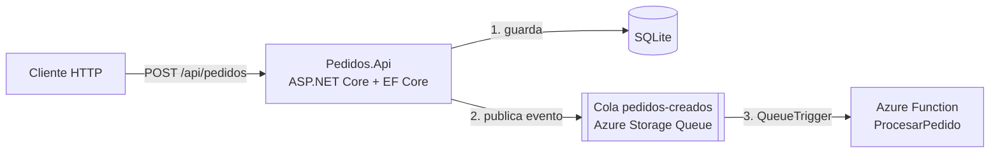

# PedidosApp

API de pedidos en **.NET 10** que guarda cada pedido con **Entity Framework Core** y publica un evento en una **cola de Azure Storage**. Una **Azure Function** consume ese evento y hace el procesamiento en segundo plano, de modo que la API responde rápido. Todo está contenerizado con **Docker** y la imagen se desplegó en **Azure Container Apps**.

Proyecto de práctica para reforzar backend con .NET y Azure.

## Arquitectura



En local, la cola la emula **Azurite**. En Azure se usa una Storage Account real.

## Stack

| Área | Tecnología |
|---|---|
| API | .NET 10, ASP.NET Core (controllers), OpenAPI |
| Datos | Entity Framework Core, migraciones, SQLite |
| Mensajería | Azure Storage Queues (Azurite en local) |
| Procesamiento | Azure Functions (isolated worker), `QueueTrigger` |
| Contenedores | Docker (multi-stage), Docker Compose |
| Nube | Azure Container Registry, Azure Container Apps |

## Estructura

```
PedidosApp/
├── docker-compose.yml          # API + Azurite
├── PedidosApp.slnx
└── src/
    ├── Pedidos.Api/
    │   ├── Controllers/PedidosController.cs
    │   ├── Data/AppDbContext.cs
    │   ├── Models/Pedido.cs        # entidad + DTOs
    │   ├── Services/IColaPedidos.cs
    │   ├── Migrations/
    │   ├── Program.cs
    │   └── Dockerfile
    └── Pedidos.Functions/
        └── ProcesarPedido.cs       # QueueTrigger
```

## Endpoints

| Método | Ruta | Descripción | Respuesta |
|---|---|---|---|
| GET | `/api/pedidos` | Lista los pedidos | 200 |
| GET | `/api/pedidos/{id}` | Obtiene un pedido | 200 / 404 |
| POST | `/api/pedidos` | Crea un pedido y publica el evento | 201 / 400 |
| DELETE | `/api/pedidos/{id}` | Elimina un pedido | 204 / 404 |
| GET | `/health` | Health check | 200 |

Ejemplo:

```json
POST /api/pedidos
{ "cliente": "Ana", "total": 4990 }
```

## Cómo ejecutarlo

**Requisitos:** .NET 10 SDK, Docker Desktop, Azure Functions Core Tools (`func`).

**1. API y Azurite con Docker Compose** (desde la raíz):

```powershell
docker compose up --build
```

La API queda en `http://localhost:8080`.

**2. Azure Function** (en otra terminal):

```powershell
cd src/Pedidos.Functions
func start
```

Se conecta a Azurite mediante `local.settings.json` (`AzureWebJobsStorage = UseDevelopmentStorage=true`).

**3. Crear un pedido:**

```powershell
Invoke-RestMethod -Method Post -Uri http://localhost:8080/api/pedidos `
  -ContentType "application/json" -Body '{"cliente":"Ana","total":4990}'
```

En la terminal de la Function aparece:

```
Procesando pedido 1 de Ana por $4990
Pedido 1 procesado OK
```

**Sin Docker (solo API):**

```powershell
cd src/Pedidos.Api
dotnet run
```

Requiere Azurite corriendo (`npm i -g azurite` y `azurite --location .azurite --skipApiVersionCheck`) para poder publicar en la cola.

## Despliegue en Azure

Resumen de lo que se hizo:

1. Resource group y **Azure Container Registry**.
2. `docker build`, `docker tag` y `docker push` de la imagen al registro.
3. **Azure Container Apps** con ingreso externo en el puerto 8080.
4. **Storage Account** para la cola; su cadena de conexión se guarda como *secret* de la app y se expone como `ConnectionStrings__Storage`.

## Decisiones de diseño

- **Entidad separada de DTOs:** la API no expone el modelo interno de la base.
- **Cola detrás de una interfaz (`IColaPedidos`):** cambiar a Service Bus no toca el controller.
- **Migraciones al arrancar:** cómodo para demo y contenedor; en producción se aplicarían desde el pipeline.
- **Dockerfile multi-stage:** compila con la imagen SDK y ejecuta con la imagen runtime, más liviana y con menos superficie de ataque. Corre como usuario sin privilegios.

## Limitaciones conocidas y mejoras

- **Doble escritura:** el pedido se guarda y después se publica en la cola. Si la cola falla, el pedido queda guardado sin evento. Mejora: **patrón Outbox**.
- **SQLite dentro del contenedor es efímero.** En producción: Azure SQL o PostgreSQL.
- **Idempotencia:** las colas entregan al menos una vez; el consumidor debería ignorar pedidos ya procesados.
- **Sin autenticación** en la API.
- **Secretos:** usar Managed Identity y Key Vault en lugar de cadenas de conexión.
- **Pruebas automatizadas** (unitarias y de integración) y **pipeline CI/CD** en Azure DevOps.
- Reemplazar Storage Queue por **Service Bus** si se necesitan topics, orden o dead-letter avanzado.
