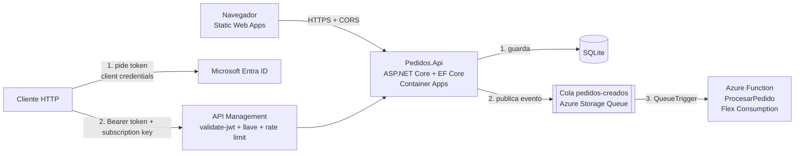

# PedidosApp

API de pedidos en **.NET 10** que guarda cada pedido con **Entity Framework Core** y publica un evento en una **cola de Azure Storage**. Una **Azure Function** consume ese evento y hace el procesamiento en segundo plano, de modo que la API responde rápido. Está contenerizada con **Docker**, desplegada en **Azure Container Apps**, publicada a través de **Azure API Management** y consumida desde un frontend en **Azure Static Web Apps**.

Proyecto de práctica para reforzar backend con .NET y Azure.

**Demo del frontend:** https://ashy-rock-0910d0a1e.3.azurestaticapps.net
*(la demo puede no estar disponible si los recursos de Azure ya fueron eliminados; la evidencia está en la carpeta [`evidencia`](evidencia))*

## Arquitectura



El frontend llama directo a la API (restringida por CORS a su origen). Los clientes externos entran por API Management, que exige un token de aplicación (OAuth 2.0, Entra ID), una subscription key y aplica un límite de llamadas. La Azure Function está desplegada en Azure (plan Flex Consumption) y consume la misma cola real que publica la API.

En local, la cola la emula **Azurite**. En Azure se usa una Storage Account real.

## Stack

| Área | Tecnología |
|---|---|
| API | .NET 10, ASP.NET Core (controllers), OpenAPI |
| Datos | Entity Framework Core, migraciones, SQLite |
| Mensajería | Azure Storage Queues (Azurite en local) |
| Procesamiento | Azure Functions (isolated worker), `QueueTrigger` |
| Contenedores | Docker (multi-stage), Docker Compose |
| Nube | Azure Container Registry, Azure Container Apps, Azure Functions (plan Flex Consumption) |
| Gateway | Azure API Management (nivel Consumption): subscription key, `rate-limit`, `validate-jwt` |
| Identidad | Microsoft Entra ID, OAuth 2.0 client credentials |
| Frontend | HTML + JavaScript simple, Azure Static Web Apps |

## Estructura

```
PedidosApp/
├── docker-compose.yml          # API + Azurite
├── PedidosApp.slnx
├── frontend/index.html         # frontend de prueba
├── evidencia/                  # capturas de la prueba en Azure
└── src/
    ├── Pedidos.Api/
    │   ├── Controllers/PedidosController.cs
    │   ├── Data/AppDbContext.cs
    │   ├── Models/Pedido.cs        # entidad + DTOs
    │   ├── Services/IColaPedidos.cs
    │   ├── Migrations/
    │   ├── Program.cs
    │   └── Dockerfile
    └── Pedidos.Functions/
        └── ProcesarPedido.cs       # QueueTrigger
```

## Endpoints

| Método | Ruta | Descripción | Respuesta |
|---|---|---|---|
| GET | `/api/pedidos` | Lista los pedidos | 200 |
| GET | `/api/pedidos/{id}` | Obtiene un pedido | 200 / 404 |
| POST | `/api/pedidos` | Crea un pedido y publica el evento | 201 / 400 |
| DELETE | `/api/pedidos/{id}` | Elimina un pedido | 204 / 404 |
| GET | `/health` | Health check | 200 |

Ejemplo:

```json
POST /api/pedidos
{ "cliente": "Ana", "total": 4990 }
```

## Cómo ejecutarlo

**Requisitos:** .NET 10 SDK, Docker Desktop, Azure Functions Core Tools (`func`).

**1. API y Azurite con Docker Compose** (desde la raíz):

```powershell
docker compose up --build
```

La API queda en `http://localhost:8080`.

**2. Azure Function** (en otra terminal):

```powershell
cd src/Pedidos.Functions
func start
```

Se conecta a Azurite mediante `local.settings.json` (`AzureWebJobsStorage = UseDevelopmentStorage=true`).

**3. Crear un pedido:**

```powershell
Invoke-RestMethod -Method Post -Uri http://localhost:8080/api/pedidos `
  -ContentType "application/json" -Body '{"cliente":"Ana","total":4990}'
```

En la terminal de la Function aparece:

```
Procesando pedido 1 de Ana por $4990
Pedido 1 procesado OK
```

**Sin Docker (solo API):**

```powershell
cd src/Pedidos.Api
dotnet run
```

Requiere Azurite corriendo (`npm i -g azurite` y `azurite --location .azurite --skipApiVersionCheck`) para poder publicar en la cola.

**Frontend:** abre `frontend/index.html` en el navegador y escribe la URL de la API. También acepta `?api=URL` en la dirección.

## Despliegue en Azure

Resumen de lo que se hizo (con Azure CLI):

1. Resource group y **Azure Container Registry**.
2. `docker build`, `docker tag` y `docker push` de la imagen al registro. Cada cambio usa un tag nuevo (`v1`, `v2`, `v3`), porque reutilizar un tag no provoca un nuevo despliegue.
3. **Azure Container Apps** con ingreso externo en el puerto 8080. Se eligió sobre App Service porque la API ya estaba en un contenedor y porque la cuenta gratuita no tenía cuota para App Service.
4. **Storage Account** para la cola; su cadena de conexión se guarda como *secret* de la app y se expone como `ConnectionStrings__Storage`.
5. **CORS** restringido al origen del frontend con la variable `Cors__Origins`.
6. **Azure Static Web Apps** (plan gratuito) para el frontend.
7. **API Management** (nivel Consumption): se importó el OpenAPI de la API, se probó que sin subscription key responde 401 y con ella 200, y se añadió la política `rate-limit` (5 llamadas por 30 segundos) que devuelve 429.
8. **Azure Function en Azure** (plan *Flex Consumption*, región Brazil South, runtime `dotnet-isolated` 10), con la misma Storage Account de la cola. Se creó con `az functionapp create` y se publicó con `func azure functionapp publish`. Al arrancar procesó los 5 mensajes que la API había dejado en la cola real sin consumidor; la cola `pedidos-creados-poison` no existe, es decir, no hubo mensajes fallidos. El panel de invocaciones del portal mostró 6 ejecuciones correctas y 0 errores, y un pedido nuevo creado en la API fue consumido en segundos.
9. **Autenticación de aplicación** con Microsoft Entra ID: dos registros de aplicación (`pedidos-api` y `pedidos-cliente`), flujo *client credentials* y política `validate-jwt` en APIM. Sin token responde 401, con token válido 200 y con token inválido 401.

### Evidencia

| Prueba | Captura |
|---|---|
| Límite de llamadas en APIM (200 y 429) | `evidencia/apim-prueba-429-powershell.png` |
| Política `rate-limit` en el portal | `evidencia/apim-politica-rate-limit.png` |
| Invocaciones de la Function en Azure (6 correctas, 0 errores) | `evidencia/function-invocaciones-azure.png` |

### Notas de la importación a APIM

.NET 10 genera OpenAPI 3.1 y escribe los números como `"type": ["number","string"]`, algo que APIM no acepta al importar. Para esta práctica se convirtió el archivo a OpenAPI 3.0 con un reemplazo de texto. En un proyecto real se configuraría la generación en 3.0 desde el código y la importación iría en el pipeline.

## Autenticación entre aplicaciones (OAuth 2.0)

La subscription key identifica qué aplicación llama y sirve para límites y cuotas, pero no autentica a nadie. Se agregó además autenticación a nivel de aplicación, sin usuarios:

1. La aplicación cliente (`pedidos-cliente`) pide un token al endpoint de Entra ID con su `client_id` y un secreto (flujo *client credentials*, scope `api://<id-de-pedidos-api>/.default`).
2. Envía la llamada a APIM con `Authorization: Bearer <token>` y la subscription key.
3. APIM valida firma, emisor y audiencia con `validate-jwt` antes de reenviar a la API.

Resultado probado desde Cloud Shell: sin token 401, token válido 200, token inválido 401. El token dura cerca de una hora y los secretos no se guardan en el repositorio.

Qué **no** cubre: el token no lleva roles (cualquier aplicación registrada en el directorio podría pedir uno; se resolvería con *app roles*), el frontend no usa este flujo y la API sigue accesible directamente sin pasar por APIM.

## Decisiones de diseño

- **Entidad separada de DTOs:** la API no expone el modelo interno de la base.
- **Cola detrás de una interfaz (`IColaPedidos`):** cambiar a Service Bus no toca el controller.
- **Migraciones al arrancar:** cómodo para demo y contenedor; en producción se aplicarían desde el pipeline.
- **Dockerfile multi-stage:** compila con la imagen SDK y ejecuta con la imagen runtime, más liviana y con menos superficie de ataque. Corre como usuario sin privilegios.
- **CORS por configuración:** los orígenes permitidos vienen de `Cors:Origins`; si no se define, queda abierto solo para desarrollo.

## Limitaciones conocidas y mejoras

- **Doble escritura:** el pedido se guarda y después se publica en la cola. Si la cola falla, el pedido queda guardado sin evento. Mejora: **patrón Outbox**.
- **SQLite dentro del contenedor es efímero** y se pierde al escalar a cero. En producción: Azure SQL o PostgreSQL.
- **La API sigue accesible directamente**, sin pasar por APIM. En producción se cerraría con ingress interno o una red virtual.
- **Autenticación solo en APIM:** hay subscription key y `validate-jwt` entre aplicaciones, pero la API no valida nada por sí misma y no hay autenticación de usuarios. Mejoras: *app roles*, y cerrar el acceso directo para que solo APIM pueda llamarla.
- **La Function es solo una simulación del trabajo en segundo plano:** registra el pedido y espera 500 ms, pero no actualiza la base de datos, así que el estado sigue en `Pendiente`.
- **Idempotencia:** las colas entregan al menos una vez; el consumidor debería ignorar pedidos ya procesados.
- **Secretos:** usar Managed Identity y Key Vault en lugar de cadenas de conexión.
- **Infraestructura como código:** definir los recursos con Bicep o Terraform, y automatizar el despliegue y la importación a APIM en un pipeline de CI/CD (no hay pipeline en este repositorio).
- **Pruebas automatizadas** (unitarias y de integración).
- Reemplazar Storage Queue por **Service Bus** si se necesitan topics, orden o dead-letter avanzado.
